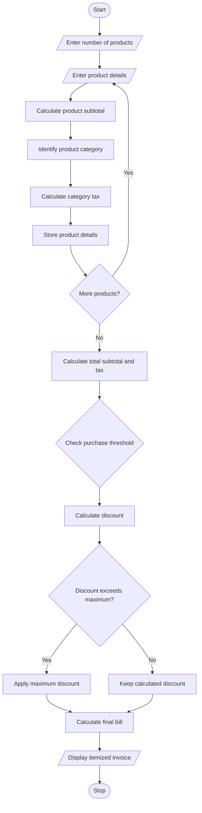

### 7\. Retail Billing with Multiple Discount Rules

### 1\. Problem Statement

Develop a Python program to generate a retail bill for multiple products based on product price, quantity, category-specific taxes, threshold discounts, and maximum concession limits.

The program should:

* Accept multiple product names, prices, quantities, and categories.

* Calculate the subtotal for each product.

* Apply category-specific taxes.

* Provide discounts based on purchase amount.

* Apply a maximum discount limit.

* Calculate the final payable amount.

* Generate an itemized invoice displaying all details.

### 2\. Algorithm

* Start the program.

* Read the number of products.

* Enter product name, price, quantity, and category.

* Calculate the subtotal of each product.

* Calculate the total purchase amount.

* Apply category-specific taxes.

* Check discount eligibility based on purchase thresholds.

* Calculate the discount amount.

* Apply the maximum concession limit.

* Calculate the final bill amount.

* Display the itemized invoice.

* Stop the program.

### 3\. Flowchart
flowchart TD
    A([Start]) --> B[/Enter number of products/]
    B --> C[/Enter product details/]
    C --> D[Calculate product subtotal]
    D --> E[Identify product category]
    E --> F[Calculate category tax]
    F --> G[Store product details]
    G --> H{More products?}
    H -- Yes --> C
    H -- No --> I[Calculate total subtotal and tax]
    I --> J{Check purchase threshold}
    J --> K[Calculate discount]
    K --> L{Discount exceeds maximum?}
    L -- Yes --> M[Apply maximum discount]
    L -- No --> N[Keep calculated discount]
    M --> O[Calculate final bill]
    N --> O
    O --> P[/Display itemized invoice/]
    P --> Q([Stop])
### 5\. Sample Input

```text
===== RETAIL BILLING SYSTEM =====

Enter number of products: 3

Product 1
Enter product name: Rice
Enter product price: 100
Enter quantity: 10
Enter category (food/clothing/electronics): food

Product 2
Enter product name: Shirt
Enter product price: 500
Enter quantity: 2
Enter category (food/clothing/electronics): clothing

Product 3
Enter product name: Headphones
Enter product price: 2000
Enter quantity: 1
Enter category (food/clothing/electronics): electronics
```

### 6\. Sample Output

```text
========== ITEMIZED INVOICE ==========

Product   Qty   Price   Amount   Tax

Rice       10    100     1000     5%
Shirt       2    500     1000     5%
Headphones  1   2000     2000    18%

--------------------------------------
Subtotal: Rs. 4000.0
Total Tax: Rs. 460.0
Discount Rate: 15 %
Discount Amount: Rs. 600.0
Maximum Discount: Rs. 1000
--------------------------------------
Final Amount: Rs. 3860.0
======================================
Thank You! Visit Again.
```

### 7\. Mermaid Flowchart Code



Result: The Python program successfully processes multiple products, calculates category-specific taxes, applies threshold-based discounts and maximum concession limits, and generates an itemized retail invoice.
