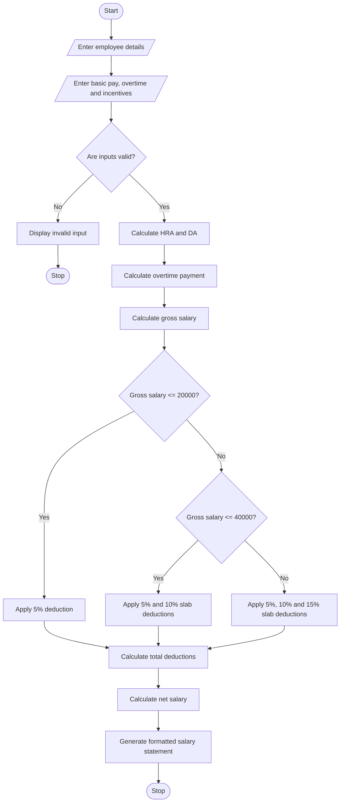

### 4\. Employee Payroll and Deduction Analysis Using Python

### 1\. Problem Statement

The Employee Payroll and Deduction Analysis System is designed to calculate an employee's monthly salary based on basic pay, allowances, overtime, and incentives.

The system calculates the gross salary and applies progressive deductions to determine the employee's net salary.

The system performs the following operations:

* Basic Pay: Accept the employee's basic monthly salary.

* Allowances: Add House Rent Allowance (HRA) and Dearness Allowance (DA).

* Overtime: Calculate additional payment based on overtime hours.

* Incentives: Add performance-based incentives.

* Progressive Deductions: Apply deductions based on gross salary.

* Net Salary: Calculate the final salary after deductions.

* Salary Statement: Generate a formatted salary statement.

### Salary Calculation Rules

Allowances:

* HRA = 20% of basic pay.

* DA = 10% of basic pay.

* Overtime rate = ₹200 per hour.

Progressive Deduction Policy:

| Gross salary    | Deduction rate |
| --------------- | -------------- |
| Up to ₹20,000   | 5%             |
| ₹20,001–₹40,000 | 10%            |
| Above ₹40,000   | 15%            |

The progressive deduction is calculated using separate salary slabs.

### 2\. Algorithm

Step 1: Start the program.

Step 2: Enter employee details:

* Employee ID

* Employee name

* Basic pay

* Overtime hours

* Incentives

Step 3: Calculate allowances.

* HRA = Basic Pay × 20%

* DA = Basic Pay × 10%

Step 4: Calculate overtime payment.

Overtime Pay = Overtime Hours × ₹200

Step 5: Calculate gross salary.

Gross Salary = Basic Pay + HRA + DA + Overtime Pay + Incentives

Step 6: Calculate progressive deductions.

* First ₹20,000: 5%

* Next ₹20,000: 10%

* Remaining amount: 15%

Step 7: Calculate net salary.

Net Salary = Gross Salary − Total Deductions

Step 8: Display the formatted salary statement.

Step 9: Stop the program.

### 3\. Flowchart
flowchart TD
    A([Start]) --> B[/Enter employee details/]
    B --> C[/Enter basic pay, overtime and incentives/]
    C --> D{Are inputs valid?}
    D -- No --> E[Display invalid input]
    E --> Z([Stop])
    D -- Yes --> F[Calculate HRA and DA]
    F --> G[Calculate overtime payment]
    G --> H[Calculate gross salary]
    H --> I{Gross salary <= 20000?}
    I -- Yes --> J[Apply 5% deduction]
    I -- No --> K{Gross salary <= 40000?}
    K -- Yes --> L[Apply 5% and 10% slab deductions]
    K -- No --> M[Apply 5%, 10% and 15% slab deductions]
    J --> N[Calculate total deductions]
    L --> N
    M --> N
    N --> O[Calculate net salary]
    O --> P[Generate formatted salary statement]
    P --> Q([Stop])
### 5\. Sample Input

```text
===== EMPLOYEE PAYROLL SYSTEM =====

Enter Employee ID: E101
Enter Employee Name: Ravi

Enter Basic Pay: Rs. 30000
Enter Overtime Hours: 10
Enter Incentives: Rs. 5000
```

### 6\. Sample Output

```text
========== SALARY STATEMENT ==========

Employee ID       : E101
Employee Name     : Ravi

---------- EARNINGS ----------

Basic Pay         : Rs. 30000.0
HRA (20%)         : Rs. 6000.0
DA (10%)          : Rs. 3000.0
Overtime Pay      : Rs. 2000.0
Incentives        : Rs. 5000.0

--------------------------------------
Gross Salary      : Rs. 46000.0

---------- DEDUCTIONS ----------

Progressive Deduction: Rs. 3900.0

--------------------------------------

Net Salary        : Rs. 42100.0

Payroll generated successfully.
```

Calculation:

Gross Salary:

30000+6000+3000+2000+5000=46000

Progressive deduction:

(20000 \\times 5\\%)+(20000 \\times 10\\%)
+(6000 \\times 15\\%)=1000+2000+900=3900

Net Salary:

46000-3900=\\boxed{42100}

### 7\. Mermaid Flowchart Code

Copy the following code into the [Mermaid Live Editor](https://mermaid.live/?utm_source=chatgpt.com) to generate the flowchart.



### 8\. Result

The Employee Payroll and Deduction Analysis System successfully calculates gross salary using basic pay, allowances, overtime, and incentives. It applies progressive deductions and generates a formatted salary statement showing total earnings, deductions, and final net salary.

Note: The salary rates and deduction percentages used in this program are sample values for an academic project. Actual payroll deductions depend on applicable employment and tax rules.
