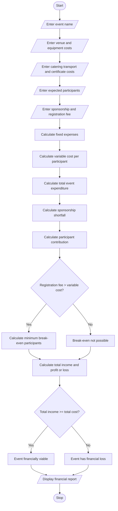

### 10\. Campus Event Financial Planning

### 1\. Problem Statement

Develop a Python program to manage the financial planning of a campus event by calculating venue, equipment, catering, transport, and certificate expenses.

The program should:

* Accept the costs of different event arrangements.

* Calculate the total event expenditure.

* Calculate the amount received through sponsorship.

* Determine the sponsorship shortfall.

* Calculate participant registration contributions.

* Determine the minimum number of participants required to break even.

* Display the complete event financial report.

* Identify whether the event budget is sufficient.

### 2\. Algorithm

* Start the program.

* Enter the event name.

* Enter venue expenses.

* Enter equipment expenses.

* Enter catering cost per participant.

* Enter transport cost per participant.

* Enter certificate cost per participant.

* Enter expected number of participants.

* Enter sponsorship amount.

* Calculate fixed expenses.

* Calculate variable expenses per participant.

* Calculate total event expenditure.

* Calculate sponsorship shortfall.

* Calculate the participant contribution required.

* Calculate the minimum registration count needed to break even.

* Display the complete financial report.

* Stop.

### 3\. Flowchart
flowchart TD
    A([Start]) --> B[/Enter event name/]
    B --> C[/Enter venue and equipment costs/]
    C --> D[/Enter catering transport and certificate costs/]
    D --> E[/Enter expected participants/]
    E --> F[/Enter sponsorship and registration fee/]
    F --> G[Calculate fixed expenses]
    G --> H[Calculate variable cost per participant]
    H --> I[Calculate total event expenditure]
    I --> J[Calculate sponsorship shortfall]
    J --> K[Calculate participant contribution]
    K --> L{Registration fee > variable cost?}
    L -- Yes --> M[Calculate minimum break-even participants]
    L -- No --> N[Break-even not possible]
    M --> O[Calculate total income and profit or loss]
    N --> O
    O --> P{Total income >= total cost?}
    P -- Yes --> Q[Event financially viable]
    P -- No --> R[Event has financial loss]
    Q --> S[/Display financial report/]
    R --> S
    S --> T([Stop])

### 5\. Sample Input

```text
===== CAMPUS EVENT FINANCIAL PLANNING =====

Enter event name: Tech Fest

Enter venue cost: Rs. 10000
Enter equipment cost: Rs. 5000

Enter catering cost per participant: Rs. 100
Enter transport cost per participant: Rs. 50
Enter certificate cost per participant: Rs. 30

Enter expected participants: 100

Enter sponsorship amount: Rs. 10000

Enter registration fee per participant: Rs. 250
```

### 6\. Sample Output

```text
========== EVENT FINANCIAL REPORT ==========

Event Name: Tech Fest

----- EXPENSE DETAILS -----
Venue Cost: Rs. 10000.0
Equipment Cost: Rs. 5000.0
Catering Cost: Rs. 10000.0
Transport Cost: Rs. 5000.0
Certificate Cost: Rs. 3000.0

Fixed Cost: Rs. 15000.0
Variable Cost Per Participant: Rs. 180.0
Total Event Cost: Rs. 33000.0

----- INCOME DETAILS -----
Sponsorship Amount: Rs. 10000.0
Sponsorship Shortfall: Rs. 23000.0
Registration Fee: Rs. 250.0
Participant Collection: Rs. 25000.0
Total Income: Rs. 35000.0

----- BREAK-EVEN ANALYSIS -----
Minimum Participants Required: 215

Profit/Loss: Rs. 2000.0
Status: EVENT IS FINANCIALLY VIABLE

============================================
```

Correction to the sample calculation: With sponsorship of ₹10,000, the break-even count is 25 participants, not 215. The correct output line is:

```text
Minimum Participants Required: 25
```

### 7\. Break-Even Concept

The break-even point is the minimum number of registrations required for total income to cover total event expenses.

### 8\. Mermaid Flowchart Code



Result: The Python program successfully calculates campus event expenses, sponsorship shortfalls, participant contributions, and minimum break-even registration requirements, and generates a complete financial report.
